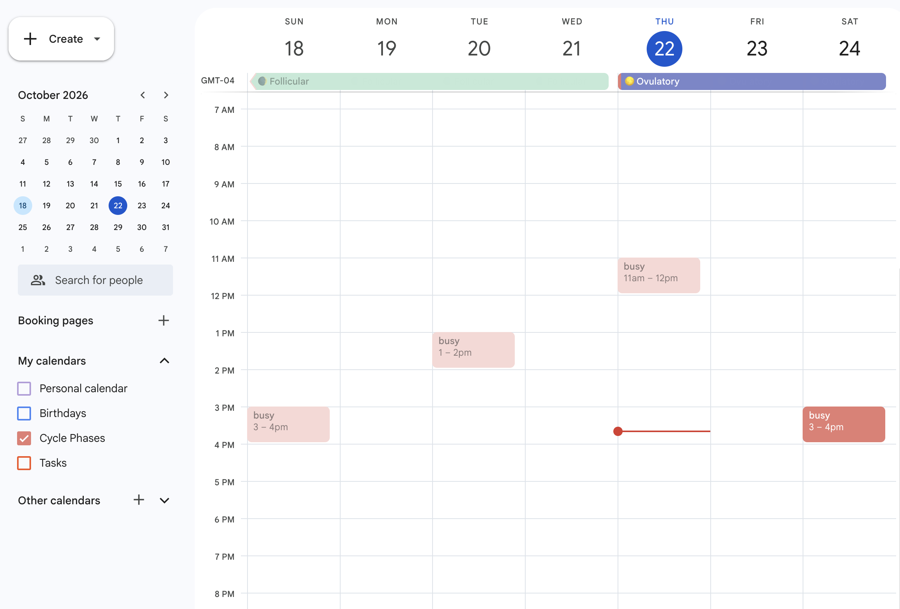
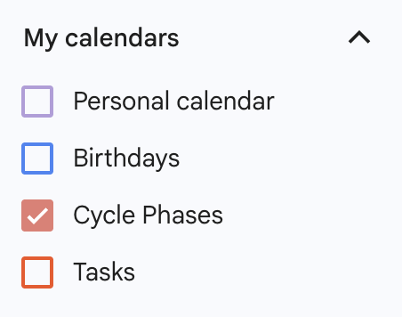
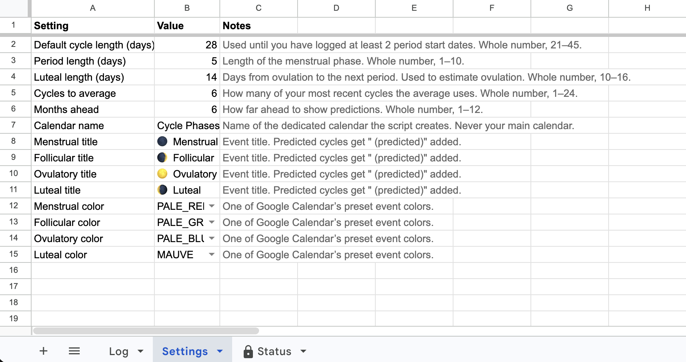

# Cycle Phase Calendar

A Google Sheet that turns your logged period start dates into estimated cycle phases on a private Google Calendar. Log a date, and color-coded all-day events appear for the months ahead, each describing what is commonly reported during that phase.



- **Four phases**: 🌑 Menstrual, 🌒 Follicular, 🌕 Ovulatory and 🌘 Luteal, one event per phase per cycle.
- **Learns your cycle** from your own logged dates.
- **Updates automatically** when you edit the sheet, and every night.
- **Stays out of the way**: events go on their own calendar, are private, and show as free so they never block your time.

> **Health disclaimer.** Phases are estimates. This is general information, not medical advice, and not suitable for contraception or for planning or avoiding pregnancy.

## Why I built this

Period tracking apps and utilities have existed for some time and yet it feels like many women (myself included) are detached from our menstrual cycle outside of menstruation itself. I wanted to make cycle phases visible right where I plan my time, my calendar. Now creating calendar events comes with the visibility of where I'm predicted to be in my cycle, in addition to a deeper understanding of how my cycle impacts me.

I chose Google Calendar because it's the calendar I personally use, as well as being one of the most used in the world. I wanted the cycle predictions to live right where I create my events, and avoid sharing health data with another health app.

## How to use

1. **Copy the template.** Open the [template sheet](https://docs.google.com/spreadsheets/d/1OABYEsLfbZQC9ZCvP1CSv-vdhMbrprRh4OzJSwLjf2s/copy) and click **Make a copy**.
2. **Set your time zone** in **File → Settings → General**. The script uses it to work out today's phase and to schedule its nightly update. (If you change it later, run **Remove** and then **Set up** again.)
3. **Run Set up** from the **Cycle Calendar** menu, which can take a few seconds to appear. When Google says it "hasn't verified this app", click **Advanced → Go to … (unsafe)**. You'll see this because the script runs from your own copy rather than a published app. See [Permissions](#privacy-and-permissions) for what it can access.
4. **Log your dates.** In the **Log** tab, replace the example date with the first day of your latest period, and add earlier ones if you have them. With two or more dates the script uses your own cycle length; with one it assumes 28 days.

That's it. A **Cycle Phases** calendar appears in Google Calendar, which you can show or hide with one checkbox:



From then on, just log each new period. The **Status** tab shows today's estimated phase, your next predicted period and any warnings. **Cycle Calendar → Sync now** forces an update, and **Remove** turns off syncing and deletes the events the script created. Remove keeps your sheet, your own events and the calendar itself.

### Settings

The **Settings** tab sets the cycle defaults, how far ahead to predict, the calendar name, and each phase's title and color. Each row notes the values it accepts. Invalid values fall back to the default and show up in Status.



## How the predictions work

**Cycle length** is the median of your most recent cycles (6 by default), so one unusual month doesn't throw it off. Gaps that look like a missed or extra log, judged against your own history, are left out, and Status lists them.

**Ovulation** is estimated by counting back 14 days (the luteal length) from the next period rather than assuming day 14, so it works for shorter and longer cycles. For a 28-day cycle:

| Menstrual | Follicular | Ovulatory | Luteal |
| --------- | ---------- | --------- | ------ |
| 1–5       | 6–12       | 13–15     | 16–28  |

Physiologically the follicular phase starts on day 1, overlapping menstruation; the calendar keeps phases separate so they're easy to read.

If your cycles vary by more than 7 days, or the predicted period passes with no new log, Status says so.

## Privacy and permissions

Everything stays in your Google account: the sheet, the calendar and the script's settings. The script makes no network calls, and the author sees nothing. The events are stored by Google under Google's terms, like anything else in your Calendar.

| Scope                      | Why                                           |
| -------------------------- | --------------------------------------------- |
| `spreadsheets.currentonly` | Read and write this sheet only                |
| `calendar`                 | Create the Cycle Phases calendar and events   |
| `script.container.ui`      | Show the menu and confirmation dialogs        |
| `script.scriptapp`         | Install the on-edit and nightly sync triggers |

## Development

TypeScript, bundled with esbuild and deployed with [clasp](https://github.com/google/clasp).

```sh
npm install
npm test           # Vitest
npm run lint
npm run typecheck
npm run build      # bundles src/ into dist/Code.js
```

To deploy to your own sheet, open **Extensions → Apps Script**, copy the script ID from **Project Settings** into a `.clasp.json` (see `.clasp.json.example`, and don't commit it), then run `npx clasp login` and `npm run push`.

```
src/
  core/        pure logic, unit tested
  content/     phase descriptions and disclaimer
  gas/         thin Apps Script adapters
  commands.ts  what each menu item and trigger does
  sync.ts      sheet → calendar and Status
  main.ts      entry points Apps Script calls
```

`src/core/` and `src/content/` use no Apps Script globals (ESLint enforces this), so all the logic is tested in Node. Core tests run in both New York and Sydney time to catch timezone bugs. Full requirements and design decisions are in [docs/SPEC.md](docs/SPEC.md).

## License

[MIT](LICENSE)
